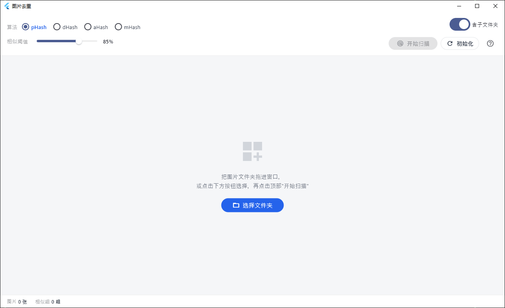

# 图片去重

一个基于 Flutter 的 Windows 桌面图片去重工具：通过感知哈希（perceptual hash）检测相似/重复图片，聚合为相似组，支持大图对比与一键清理（移入系统回收站，可还原）。



## 功能特性

- **多种哈希算法**：内置 pHash / dHash / aHash / mHash 四种感知哈希算法，界面单选切换，悬浮可查看算法说明
  - pHash 感知哈希（基于 DCT 频率域，抗缩放/压缩/轻微水印，推荐默认）
  - dHash 差异哈希（相邻像素梯度，速度快，对亮度变化不敏感）
  - aHash 均值哈希（速度最快，精度一般）
  - mHash 中值哈希（抗局部亮度突变）
- **相似阈值可调**：50%–100% 实时筛选，调整阈值即时重新分组，无需重新扫描
- **相似组聚合**：基于相似对并查集聚合相似组，组内显示最低相似度，按相似度从高到低排序
- **大图对比预览**：点击左侧相似组，右侧并排展示组内图片（文件名、尺寸、大小）
- **多种删除方式**（均移入系统回收站，可还原）
  - 单张删除：预览图右上角删除按钮
  - 删除本组多余图片：每组保留 1 张
  - 一键清理：清理全部相似组的多余图片
  - 多选批量删除：勾选多个相似组，或按"相似度低于 N%"批量选中
- **文件夹拖拽**：直接把文件夹拖入窗口即可作为扫描目录
- **子文件夹扫描**：可选是否递归包含子文件夹
- **哈希缓存**：按 路径 + 大小 + 修改时间 缓存哈希与缩略图，二次扫描显著加速
- **并行扫描**：多 isolate 并行解析图片，扫描过程可随时取消
- **窗口状态记忆**：自动保存/恢复窗口位置与大小
- **崩溃日志**：全局错误写入 `crash_log.txt`，便于定位问题

## 界面说明

- **顶部工具栏**：左侧选择算法与相似阈值，右侧显示当前文件夹、子文件夹开关与操作按钮（开始扫描 / 取消 / 初始化 / 一键清理 / 使用说明）
- **左栏（相似组列表）**：展示所有相似组，可切换"相似组 / 已删除"页签，支持多选删除
- **右栏（组内对比）**：选中相似组后展示组内大图
- **底部状态栏**：显示图片总数、相似组数、已删除数、扫描耗时

## 使用步骤

1. 选择待检测的图片文件夹（拖入窗口，或点击"选择文件夹"），可含子文件夹
2. 悬浮"算法"单选框查看说明，选择算法后点击"开始扫描"
3. 调整相似阈值，实时筛选相似组
4. 点击左侧相似组，右侧查看大图对比
5. 删除多余图片（单张 / 本组 / 一键清理 / 多选批量），文件移入系统回收站可还原

> 相似度 = 哈希相同位数占比，100% 表示完全一致；默认阈值 85%，阈值越高判定越严格。

## 支持的图片格式

`.jpg` `.jpeg` `.png` `.webp` `.bmp` `.gif`

## 下载安装包

前往 [Releases](https://github.com/wp993080086/image-dedup-tool/releases) 页面下载最新的 `image-dedup-windows.zip`，解压后直接运行其中的 `image_dedup.exe` 即可（无需安装）。

> 发布新版本：推送 `v*` 格式的标签（如 `v1.0.0`）会触发 GitHub Actions 自动构建并发布，详见 [release.yml](.github/workflows/release.yml)。

## 环境要求

- Windows 10 及以上
- Flutter SDK（Dart SDK `^3.6.2`）
- Visual Studio（含 C++ 桌面开发工作负载，用于构建 Windows 应用）

## 快速开始

```bash
# 获取依赖
flutter pub get

# 运行（Windows 桌面）
flutter run -d windows

# 运行测试
flutter test

# 构建 Release 版本
flutter build windows
```

构建产物位于 `build/windows/x64/runner/Release/`。

## 项目结构

```
lib/
├── main.dart              # 应用入口：主题、窗口初始化、关闭拦截
├── home.dart              # 主页面：扫描流程、分组、删除逻辑
├── models.dart            # 数据模型：ImageData / SimilarPair / SimilarGroup / ScanResult
├── scan_service.dart      # 扫描服务：图片收集、哈希算法、并行扫描、分组
├── cache_service.dart     # 哈希缓存：按路径+大小+修改时间命中
├── recycle_bin.dart       # 删除文件：Windows 移入回收站（FFI 调用 shell32）
├── window_state.dart      # 窗口位置/大小持久化
├── crash_log.dart         # 全局错误日志
├── utils.dart             # 相似度配色、大小/耗时格式化
└── widgets/
    ├── toolbar.dart       # 顶部工具栏与使用说明弹窗
    ├── group_list.dart    # 相似组列表 / 已删除列表
    └── group_preview.dart # 组内大图对比预览
```

## 技术实现

- **感知哈希**：图片统一转为灰度图后按算法生成 64-bit 指纹，两图相似度按汉明距离线性换算（`1 - 汉明距离 / 64`）
- **分组**：以相似度 >= 阈值的图片对构建并查集，聚合出相似组，组相似度取组内最低相似度
- **性能**：扫描在后台 isolate 中执行，未命中缓存的图片按 CPU 核数（上限 4）分派给多个 worker isolate 并行解析
- **删除**：Windows 下通过 FFI 调用 `SHFileOperationW`（`FOF_ALLOWUNDO`）移入回收站，批量删除在后台 isolate 执行避免阻塞 UI

## 许可证

本项目基于 [MIT License](LICENSE) 开源。
